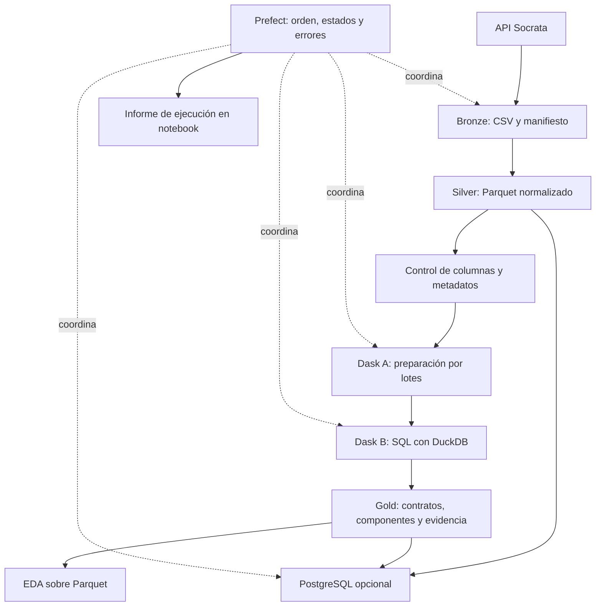
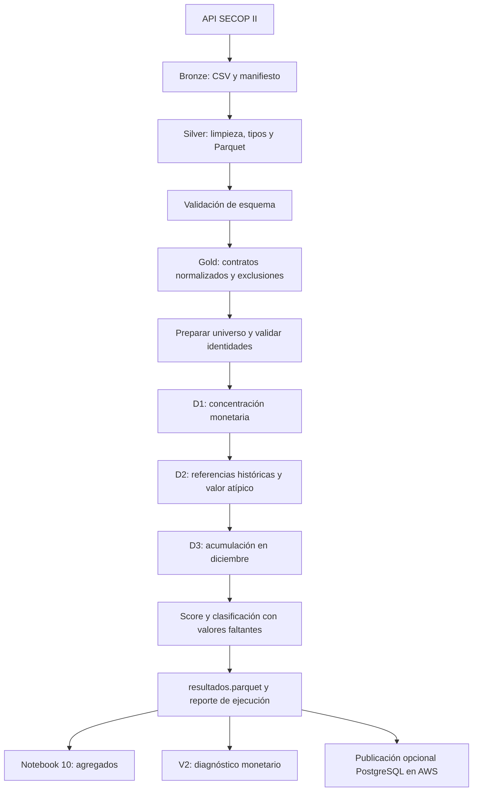

# ETL SECOP II: funcionamiento, arquitectura y operación

**Documento para presentación técnica y funcional · 9 de octubre de 2026**

Proyecto: `secop_pipeline_equipo`. Descripción basada en código y evidencias locales. Las cifras de ejecución son una fotografía histórica; este documento no se actualiza automáticamente.

## Estado actual y cómo leer este documento

El proyecto tiene **dos flujos consecutivos e independientes**:

1. `flows/secop_flow.py` prepara Bronze, Silver y Gold, y permite cargar las bases en PostgreSQL.
2. `flows/alertas_flow.py` parte de Gold y calcula el modelo vigente **`alertas-cd-2.0`**: D1 concentración monetaria, D2 valor atípico y D3 acumulación de contratos en diciembre. Un contrato queda en ALERTA cuando tiene al menos dos señales.

Las secciones 1–18 documentan el ETL base. Los componentes C/R/A e IRCD que todavía se calculan en Gold son distintos del indicador binario D1/D2/D3. La **sección 19** documenta el flujo actual de alertas, sus recursos, resultados, ejecución y diagnóstico V2; es la referencia para presentar la clasificación vigente.

**V2 es un notebook de diagnóstico monetario.** No significa que el modelo 2.1 esté implementado ni que los resultados 2.0 ya excluyan valores monetarios sospechosos. Las cifras aquí son evidencia histórica del lote indicado, no un monitor en vivo.

## 1. Resumen ejecutivo

El proyecto transforma datos de SECOP II en una base analítica para priorizar contratos de contratación directa que requieren revisión. Extrae cuatro conjuntos de datos desde Datos Abiertos, conserva originales, normaliza tipos y categorías, resuelve versiones contractuales y calcula componentes de concentración, recurrencia y valor atípico.

Prefect coordina el recorrido; Dask ejecuta dos etapas con diferentes recursos; DuckDB realiza la analítica sobre Parquet. PostgreSQL es una publicación adicional y opcional. La unidad final es **un contrato identificado por `id_contrato`**.

Las señales estadísticas orientan revisión: no prueban irregularidad ni representan una probabilidad de corrupción. Es **ETL**, porque transforma antes de cargar en PostgreSQL.

### Características principales

- Capas Bronze–Silver–Gold: originales, normalizados y analíticos.
- Extracción explícita o reutilización local con manifiesto y hashes SHA-256.
- Procesamiento por lotes para limitar los datos simultáneos en memoria.
- Dos clústeres Dask locales, secuenciales y con recursos registrados.
- Trazabilidad de originales, exclusiones y conciliación de filas.
- Publicación PostgreSQL mediante COPY y una transacción para las cinco tablas.
- Notebooks para ejecución, consulta, EDA e informe de ejecución.
- Silver tiene caché por partición; Gold todavía se reconstruye en cada flujo completo.

## 2. Arquitectura



Los notebooks 01–04 permiten ejecutar etapas manualmente. El notebook 05 y el comando de consola llaman al flujo completo: no necesitan ejecutar los anteriores además del flujo. El EDA no se ejecuta automáticamente con Prefect.

## 3. Fuentes y alcance

| Base | ID Socrata configurado | Extracción | Papel actual |
|---|---|---|---|
| Procesos | `p6dx-8zbt` | Mensual por publicación | Auxiliar |
| Contratos | `jbjy-vk9h` | Mensual por firma | Principal de Gold |
| Proveedores | `qmzu-gj57` | Catálogo paginado | Auxiliar |
| Grupos | `ceth-n4bn` | Catálogo paginado | Auxiliar |

Se seleccionan columnas configuradas, no todos los campos de la fuente. El periodo depende de configuración y manifiesto. Las fechas nulas no satisfacen las consultas mensuales; la extracción no equivale a todos los registros posibles de SECOP II.

**Gold utiliza contratos.** No une las otras tres bases para calcular el IRCD; estas sí se extraen, transforman y cargan cuando se solicita PostgreSQL. La API puede cambiar entre páginas: los archivos obtenidos no constituyen una fotografía transaccional garantizada de la fuente remota.

## 4. Estructura de carpetas

```text
secop_pipeline_equipo/
├── secop_pipeline/                 Lógica reutilizable del ETL
├── flows/secop_flow.py              Orquestación Prefect
├── scripts/                        Comandos y diagnóstico
├── notebooks/                      Ejecución y análisis interactivo
│   ├── 00 ... 08                   Detalle en sección 10
│   ├── informes_etl/               Históricos por ejecución
│   └── historico_enfoque_proveedor/ Trabajo del objetivo anterior
├── data/
│   ├── bronze/                     CSV de las cuatro bases y manifiesto
│   ├── bronze.previous-<uuid>/      Respaldos anteriores
│   ├── silver/                     Parquet por base y metadatos de caché
│   └── gold/
│       ├── contratos_control/
│       │   ├── contratos.parquet
│       │   ├── auditoria_ircd.json
│       │   └── exclusiones/exclusiones.parquet
│       └── procesos_modelo/        Salida histórica del objetivo anterior
├── salida/                         Manifiesto y reporte operativo de calidad
├── .dask-spill/                    Temporales de Dask
├── docs/                           Documentación actual e histórica
├── sql/00_info.sql                 Consultas de referencia para DBeaver
├── tests/                          Pruebas sintéticas
├── .vscode/                        Configuración del editor
├── .env                            Configuración local y credenciales
├── .env.example                    Plantilla de configuración
├── ircd_config.json                Parámetros versionados del IRCD
├── docker-compose.yml              PostgreSQL 16 y volumen persistente
├── environment.yml                 Conda secop, Python 3.12.6
├── requirements.txt                Dependencias y rangos de versiones
├── .gitignore                      Exclusiones de control de versiones
└── README.md                       Guía general
```

### Archivos operativos y temporales

| Elemento | Función y precaución |
|---|---|
| `.pipeline.lock` | Bloquea flujos simultáneos y guarda PID; puede quedar tras un cierre abrupto |
| `.bronze-*` | Descarga provisional antes de publicar Bronze |
| `.gold-preparation-*` | Archivos normalizados de A |
| `.gold-result-*` | Resultado provisional de B y temporales de DuckDB |
| `*.parquet.meta.json` | Huella y métricas para decidir la reutilización de Silver |
| `salida/manifest_extraccion.json` | Copia del manifiesto operativo |
| `salida/reporte_calidad.csv` | Resultado de controles estructurales, no exportación del EDA |
| `salida/banco_dask.csv` | Artefacto histórico; no acredita los recursos de la ejecución actual |
| `__pycache__` | Caché de Python, no datos de negocio |

Los temporales no son resultados publicados. Los respaldos Bronze consumen disco y no se eliminan automáticamente. La publicación por renombrados recupera excepciones controladas, pero no es una transacción de sistema de archivos ante un corte de energía.

## 5. Recorrido de depuración

### 5.1 Extracción → Bronze

`extract.py` usa `SocrataClient`, HTTP y paginación para obtener CSV. Procesos y contratos se separan por mes; los catálogos, por partes. El lote habitual de API es de 50.000 registros, configurable.

Con `refresh=True`, se prepara una descarga nueva y se publica al terminar; se conserva Bronze anterior. Con `refresh=False`, se verifican manifiesto y hashes, sin descargar. Las fechas explícitas deben ser compatibles con el manifiesto reutilizado.

Bronze permite comprobar qué entregó la fuente y repetir transformaciones. No corrige por sí mismo datos económicos erróneos.

### 5.2 Bronze → Silver

`transform.py` lee bloques de 50.000 filas, por defecto, y escribe Parquet con Snappy.

| Transformación | Motivo | Riesgo o límite |
|---|---|---|
| Recortar espacios y reconocer centinelas | Homogeneizar textos y faltantes | No convertir categorías significativas en nulos |
| Tipar importes | Permitir cálculos | Un número válido puede seguir siendo económicamente absurdo |
| Tipar fechas | Calcular periodos y duraciones | Interpretación UTC; revisar análisis horarios |
| Mantener identificadores como texto | Conservar códigos y ceros iniciales | No tratarlos como cantidades |
| Añadir originales `raw__` en contratos | Comparar recibido y normalizado | Mayor tamaño de almacenamiento |
| Registrar conversiones fallidas | Hacer visible información no utilizable | El valor normalizado queda nulo |

`no aplica` y `no adjudicado` no se eliminan como centinelas globales. Los números se interpretan primero con el formato decimal de la fuente y después con alternativas locales cuando corresponde.

Silver no filtra filas de negocio ni deduplica. Su caché depende del CSV y del código/reglas de transformación. Retira particiones que ya no pertenecen al Bronze activo. Su función es separar la limpieza de los cálculos analíticos.

### 5.3 Calidad

`quality.py` cuenta archivos, filas y tamaño mediante metadatos y verifica columnas esperadas, considerando aparte `raw__`. Un esquema incompatible detiene el flujo.

Es un control estructural: no certifica importes, identidades o legalidad. Las validaciones de unicidad y conservación se realizan adicionalmente en Gold.

### 5.4 Preparación de Gold

A normaliza contratos, acentos y categorías, preservando originales. Construye causal, segmento causal–tipo contractual, clase aproximada de persona y huella de los campos originales retenidos.

La entidad se identifica por NIT normalizado. El proveedor prioriza código SECOP; alternativamente utiliza tipo documental + documento. El nombre no es clave. CC, CE y pasaporte reconocidos permiten clasificar persona natural; NIT y tipos desconocidos quedan indeterminados. No se inventa un dígito verificador ni una conciliación entre códigos cambiantes.

La preparación conserva todas las filas y comprueba conteos antes de B.

### 5.5 Versiones y exclusiones en Gold

1. Detectar registros sin ID contractual.
2. Ordenar versiones por última actualización antes de filtrar modalidad.
3. Conservar la última versión inequívoca y colapsar repeticiones idénticas.
4. Excluir versiones anteriores y variantes ambiguas que no permitan elegir con seguridad.
5. Seleccionar modalidad normalizada exacta `contratacion directa`.
6. Excluir firmas posteriores al corte y aplicar el filtro de personas.
7. Conservar contratos con componentes incompletos cuando falte información necesaria para puntuar.

`Contratación directa con ofertas` no entra por similitud de nombre. La huella compara campos retenidos, no campos que nunca se descargaron. Excluir ambigüedades reduce cobertura, pero evita elegir arbitrariamente una versión.

Las exclusiones conservan ID, huella, archivo y motivo; los detalles permanecen en Bronze/Silver. Se exige:

```text
filas de entrada = contratos de Gold + filas de exclusiones
```

Una reducción no equivale solamente a duplicados: también incluye selección del universo y resolución de versiones. Convertir valores inválidos a nulos afecta información utilizable sin eliminar la fila.

### 5.6 Joins y relaciones

Gold incorpora agregados derivados de contratos: participaciones por entidad/proveedor/año/segmento, recurrencias diarias y referencias estadísticas. Los `LEFT JOIN` del enriquecimiento final conservan contratos sin referencia y producen componentes nulos. También existen joins internos al construir referencias auxiliares.

Se comprueba ID único y conservación de contratos tras los cruces. Identidades inconsistentes pueden fragmentar proveedores; agregados con claves duplicadas podrían multiplicar filas. Conciliar conteos detecta multiplicación, pero no demuestra identidad correcta.

## 6. Componentes IRCD conservados en la construcción de Gold

| Componente | Medición | Requisitos |
|---|---|---|
| C: concentración | Participación del valor del proveedor dentro de entidad–año–segmento | Identidades, importes, volumen y referencia suficientes |
| R: recurrencia | Contratos del par entidad–proveedor en ventana inclusiva desde firma−365 días hasta firma | Cobertura temporal, segmento y referencia suficientes |
| A: valor atípico | Valor mensual equivalente frente a grupo comparable | Servicios, duración válida y categorías previamente validadas |

Cada componente toma 0, 1 o 2. C y R utilizan P90/P95 de referencias históricas. La referencia R usa el máximo conteo móvil de cada par/año. A compara con el último año de línea base y requiere además razón frente a mediana ≥1,5 para puntuación alta.

Valor mensual equivalente: `valor_total × 30,44 / duración_días`; la duración incluye ambos extremos. No equivale automáticamente a salario o remuneración mensual real.

IRCD suma los tres componentes solo si existen todos. Por defecto: 0–1 seguimiento ordinario; 2–3 revisión preliminar; 4–6 revisión prioritaria. Si falta alguno, el índice es nulo y se conservan los componentes disponibles.

### Configuración vigente en `ircd_config.json`

- Línea base 2022–2024; validación 2025; seguimiento 2026.
- Personas: `todos`; se puede restringir consistentemente el universo y denominadores.
- Mínimos principales: 30 contratos/observaciones según componente.
- Máxima duración para mensualización: 1.096 días.
- `accept_recurrence_ties=False`: con P90=P95, R queda sin puntuar por defecto.
- `monthly_validated_categories=[]`: A no se puntúa hasta validar categorías comparables.

**Límite fundamental:** el ETL puede terminar correctamente y el índice compuesto continuar incompleto. La auditoría actual registra 4.353.720 índices incompletos y cero completos. No presentar una clasificación integral IRCD como si estuviera disponible.

La interpretación es una fotografía anual al corte, no una alerta histórica disponible al firmar. Se usa total contractual reportado, no valor inicial certificado. Comparar monetariamente con 2024 exige revisar inflación y composición. La línea base no recibe puntajes calculados con sus propios umbrales.

## 7. Clústeres Dask de construcción de Gold

El scheduler asigna tareas; los workers ejecutan cálculos; el Nanny supervisa procesos. Un cierre al terminar una etapa es normal. `KilledWorker` durante el cálculo exige diagnóstico.

Son clústeres locales en un mismo computador. Primero se crea y cierra A; después se crea B.

| Propiedad | A: preparación | B: analítica |
|---|---|---|
| Workers predeterminados | 2 | 1 |
| Hilos por worker | 1 | 1 |
| Máximo automático por worker con RAM suficiente | 3 GiB | 6 GiB |
| Trabajo | Normalizar y escribir contratos | Versiones, agregados, ventanas y scores |
| Motor | Dask + Arrow + pandas | Una tarea Dask con DuckDB |
| Procesamiento | Lotes de 5.000 filas | SQL y temporales en disco |
| Concurrencia | Hasta dos tareas enviadas a la vez | Una tarea relacional principal |
| Presupuesto interno DuckDB | No aplica | 50% de memoria del worker |

### Adaptación a la máquina

Presupuesto total automático por etapa: `min(6 GiB, 50% de RAM disponible)`. Se divide entre workers y redondea hacia abajo a múltiplos de 64 MiB. Se vuelve a comprobar antes de cada etapa y se reduce si hace falta. Mínimo: 512 MiB por worker.

Son límites, no memoria reservada. Los dos clústeres no suman 12 GiB porque funcionan consecutivamente. En equipos pequeños el límite se reduce automáticamente; el número de workers no se ajusta por CPU, permanece configurado.

Variables: `DASK_PREP_WORKERS`, `DASK_JOIN_WORKERS`, `DASK_PREP_MEMORY`, `DASK_JOIN_MEMORY`. Mantener ambas memorias vacías habilita el modo automático; definir ambas al configurar manualmente. JOIN es un nombre histórico para la etapa analítica. `DASK_PREP_BATCH_ROWS` admite de 1 a 10.000 filas, con 5.000 por defecto.

### Memoria y límites de escalabilidad

Protecciones Dask: objetivo 60%, spill 70%, pausa 80%, terminación 95%. Spill significa descargar datos a disco; no controla todos los temporales internos de pandas, por lo que también se limita el lote.

A devuelve contadores, no DataFrames completos, al coordinador. B utiliza un hilo de DuckDB y su propio spill; no distribuye una consulta entre múltiples workers. El procesamiento por lotes/disco admite datos mayores que la RAM, pero no proporciona escalado horizontal automático ni tiempos constantes.

**No es un benchmark:** los dos clústeres hacen trabajos distintos. Sus tiempos no permiten comparar velocidades para una misma tarea. `benchmark_dask()` es un alias obsoleto que construye Gold; ejecutarlo aparte repetiría trabajo.

## 8. Función de cada módulo

| Archivo | Qué hace y cómo se relaciona |
|---|---|
| `secop_pipeline/__init__.py` | Define el paquete importable |
| `config.py` | Rutas, fuentes, columnas, tipos y variables de entorno compartidas |
| `extract.py` | Cliente Socrata, validación, descarga mensual/catálogos, manifiesto y hashes; produce Bronze |
| `transform.py` | `clean_text`, `to_number`, `to_date`, transformación por archivo/base y caché; produce Silver |
| `quality.py` | `parquet_metadata`, `schema_check`, `build_quality_report`; valida Silver |
| `control.py` | Normalización, identidad, persona, huellas y funciones de scores |
| `control_config.py` | `ControlConfig`, validación de parámetros y huella de configuración |
| `control_analytics.py` | `analyze_contracts`: SQL de versiones, referencias, componentes y exclusiones |
| `dask_jobs.py` | `_settings`, `_prepare_file`, `_prepare`, `_finish`, `build_gold`; clústeres, recursos y temporales |
| `load.py` | Tipos SQL, nullable, CSV/COPY, tablas de preparación, publicación e índices |
| `db.py` | Motor SQLAlchemy, espera de disponibilidad y creación de esquemas |
| `models.py` | ORM de `ContratoControl` y clases históricas |
| `orm.py` | Consultas de ejemplo `sample_contracts`; el ejemplo antiguo pide usar el enfoque contractual |
| `storage.py` | Bloqueo de flujos y publicación recuperable de directorios |
| `audit.py` | `RunAudit`: estados, métricas y generación de informes en notebooks |
| `flows/secop_flow.py` | Tareas y orden del flujo `SECOP-II-CONTROL-ETL` |

### Scripts y archivos auxiliares

| Archivo | Función |
|---|---|
| `scripts/run_pipeline.py` | CLI: descarga/reutilización, fechas, recursos y publicación opcional; no tiene opción de solo PostgreSQL |
| `scripts/db_status.py` | Espera conexión y lista tablas; no certifica actualización de datos |
| `scripts/compare_manifests.py` | Compara filas y hashes de dos manifiestos; no contenido semántico |
| `sql/00_info.sql` | Consultas de referencia de base, usuario y tablas; no crea el ETL |
| `tests/test_control.py` | Casos sintéticos de reglas |
| `tests/test_control_pipeline.py` | Integración sintética; no mide rendimiento de toda la fuente |
| `docker-compose.yml` | PostgreSQL 16, puerto configurable, healthcheck y volumen persistente |
| `environment.yml` | Entorno Conda y versión Python |
| `requirements.txt` | Dependencias con rangos; no es un lockfile exacto |
| `.env.example` | Plantilla; `.env` guarda valores locales, que no deben exponerse al presentar |

## 9. Bibliotecas utilizadas

| Biblioteca/herramienta | Uso concreto |
|---|---|
| requests | HTTP a Socrata |
| pandas / NumPy | Limpieza, tipado, lotes y cálculos auxiliares |
| PyArrow | Parquet, metadatos y conservación de tipos |
| Dask/distributed | Tareas en procesos locales y gestión de workers |
| DuckDB | SQL sobre Parquet, joins, ventanas y referencias |
| Prefect | Orquestación, registros, estados y reintentos configurados |
| psycopg | Conexión y carga masiva COPY |
| SQLAlchemy | Motor y ORM; no realiza la carga masiva principal |
| python-dotenv | Configuración local |
| psutil | Medición de RAM y CPU |
| JupyterLab/ipykernel | Notebooks interactivos |
| matplotlib | Gráficos del EDA |
| tqdm | Dependencia de progreso; no sustituye registro de tareas |
| pathlib/json/hashlib/unittest | Rutas, manifiestos, huellas y pruebas de biblioteca estándar |

El informe registra versiones realmente usadas. Instalar de nuevo los rangos de dependencias no garantiza las mismas versiones exactas.

## 10. Rol de los notebooks

| Notebook | Propósito |
|---|---|
| `00_verificar_entorno.ipynb` | Entorno y dependencias |
| `01_extraccion_api.ipynb` | Extracción o reutilización de Bronze |
| `02_transformacion_silver.ipynb` | Transformación y revisión de Silver |
| `03_dask_gold.ipynb` | Construcción Gold y evidencia de recursos |
| `04_postgres_orm.ipynb` | Carga/consultas PostgreSQL y ORM |
| `05_prefect_pipeline.ipynb` | Selector de modos y ejecución |
| `06_control_contratacion_directa.ipynb` | Cobertura, bandeja, componentes y ficha de contrato |
| `06_eda_recomendacion_empresas.ipynb` | Referencia al enfoque anterior |
| `07_informe_ejecucion_etl.ipynb` | Informe generado de la ejecución más reciente |
| `08_eda_fedesarrollo_control.ipynb` | Modalidades, concentración, estacionalidad, recurrencia y sensibilidad |
| `09_dimensiones_indicador.ipynb` | Ejecuta alertas D1/D2/D3 desde Gold; define lote y publicación opcional |
| `10_agregados_indicadores.ipynb` | Resume resultados por dimensión, clasificación y agrupaciones |
| `11_monitor_alertas.ipynb` | Consulta avance, caché, workers y enlace al dashboard en otro kernel |
| `V2.ipynb` | Diagnostica valores monetarios sospechosos sin modificar el pipeline |

El 08 adapta preguntas descriptivas de Fedesarrollo; no reproduce todas las fuentes ni el índice IMCO. Explica motivo, método y conclusiones, manteniendo resultados en el notebook. Los EDA no se actualizan automáticamente al correr Prefect; sus resultados guardados pueden corresponder a otro snapshot.

## 11. Publicación PostgreSQL

`load_all_to_postgres(replace=True)` carga en orden procesos, contratos, proveedores, grupos y Gold. Lee lotes de 50.000 filas, convierte a CSV en memoria y envía `COPY FROM STDIN`.

La conversión Arrow→pandas conserva enteros nullable: evita enviar `153.0` a BIGINT y evita una conversión flotante innecesaria. Nulos permanecen nulos.

Cada tabla se prepara con nombre `_etl_<uuid>`. Cuando todas están cargadas, se reemplazan las publicadas y crean índices dentro de una transacción. Un fallo revierte esa transacción. `replace=False` está deshabilitado: no hay append ni UPSERT. Exclusiones no se carga como contratos porque solo se leen Parquet del nivel superior.

Se indexan identificadores de procesos/contratos/proveedores, ID único de Gold, entidad–año y estado–IRCD. La salida antigua `gold.procesos_modelo` no se actualiza con este enfoque.

### Demoras y concurrencia

El Parquet comprimido ocupa menos que su representación CSV y que tablas más índices. La carga necesita CPU, disco y registro transaccional aun con PostgreSQL local. El log se emite al terminar cada archivo: Gold tiene un archivo grande y puede procesar muchos lotes sin mostrar otro mensaje.

El bloqueo asesor serializa `load_all_to_postgres`; no elimina una segunda solicitud. El modo directo no utiliza el bloqueo completo del flujo. No ejecutar recuperación y flujo simultáneamente.

## 12. Cómo ejecutar sin repetir trabajo

En el notebook 05 se cambia únicamente `MODO`:

| Modo | Bronze | Silver | Gold | PostgreSQL |
|---|---|---|---|---|
| `solo_postgres` | No procesa | Lee existente | Lee existente | Carga |
| `reprocesar_local` | Reutiliza | Caché o transformación | Reconstruye | Carga |
| `actualizar_todo` | Descarga | Caché o transformación | Reconstruye | Carga |

El selector `if/elif` ejecuta una ruta. La línea `resultado` solo muestra el resultado; ejecutar nuevamente la celda sí solicita otra carga.

```python
# Flujo sobre datos locales: reconstruye Gold.
from flows.secop_flow import secop_flow
resultado = secop_flow(refresh=False, load_postgres=True)
```

```python
# Actualización desde API y publicación completa.
resultado = secop_flow(refresh=True, load_postgres=True)
```

```python
# Construir Parquet sin publicar PostgreSQL: también reconstruye Gold.
resultado = secop_flow(refresh=False, load_postgres=False)
```

```python
# Recuperar solo una carga fallida con Gold ya generado.
from secop_pipeline.load import load_all_to_postgres
resultado = load_all_to_postgres(replace=True)
```

Reiniciar el kernel tras modificar módulos evita utilizar funciones antiguas. La carga directa no genera un nuevo informe completo de Prefect ni cambia un informe histórico fallido. Para consultar Gold existente no es necesario correr el ETL.

### Consola desde la raíz

```powershell
conda activate secop
# Reutilizar descarga, construir Gold y publicar SQL
python scripts/run_pipeline.py --reuse-bronze
# Descargar nuevamente y ejecutar todo
python scripts/run_pipeline.py --refresh-bronze
# Construir sin PostgreSQL
python scripts/run_pipeline.py --reuse-bronze --no-postgres
```

Revisar fechas, `.env` e `ircd_config.json` antes de actualizar. `IRCD_CONFIG` permite elegir otra configuración analítica.

## 13. Recurrencia, escalabilidad y recuperación

Prefect ordena validación API cuando se descarga, extracción, cuatro transformaciones, calidad, Gold y PostgreSQL opcional. Los decoradores declaran tres reintentos para validación API y dos para extracción; las otras tareas no declaran reintentos explícitos en el flujo.

Puede reprocesar más datos con esquema compatible. Una fuente con estructura diferente exige adaptación. Tener Prefect no configura por sí solo un calendario: programación recurrente/deployment es trabajo operativo adicional.

La actualización es por snapshot. No hay CDC ni incremental completo por registro. Silver reutiliza particiones; Gold se reconstruye y SQL reemplaza tablas. Las dos configuraciones Dask permiten procesar por lotes y disco, pero el volumen sigue aumentando tiempos y almacenamiento.

## 14. Auditoría y estados

`RunAudit` conserva ID de ejecución, parámetros, hashes de código, versiones, métricas y estados. Se actualiza al entrar/salir de tareas; no es una barra de progreso por consulta SQL o lote COPY.

| Señal | Interpretación |
|---|---|
| Tarea completada | Terminó una etapa, no necesariamente todo el flujo |
| Informe completo y PostgreSQL completada | Terminó la publicación solicitada |
| `EN_CURSO` con timestamp antiguo | Puede ser tarea larga; contrastar actividad |
| `KilledWorker` | Murió un worker: consultar logs y recursos |
| Error WebSocket keepalive | Falló comunicación; no demuestra por sí solo fallo del cálculo |
| `idle in transaction` | Espera otra instrucción; puede ser preparación de lote o espera anormal |
| Archivos temporales | Preparación o actividad, no publicación final |

La existencia de tablas no prueba actualización: podrían ser del snapshot anterior. Los informes antiguos del enfoque anterior se conservan como historia.

## 15. Evidencia histórica del ETL base (anterior a las alertas 2.0)

**Ejecución `20261008T135741-19e4f5d1`: COMPLETADA.** Fuente: [informe](../notebooks/informes_etl/20261008T135741-19e4f5d1.ipynb). Inicio 08:57:41; fin 10:36:35 del 9 de octubre de 2026, hora Colombia. Duración aproximada: **1 h 38 min 54 s**. Reutilizó Bronze: no representa una descarga completa.

| Etapa | Tiempo observado |
|---|---:|
| Reutilización Bronze | 11,20 s |
| Silver procesos | 5,50 s |
| Silver contratos | 11,37 s |
| Silver proveedores | 0,58 s |
| Silver grupos | 0,32 s |
| Calidad | 1,23 s |
| Gold | 54 min 50 s |
| PostgreSQL | 43 min 31 s |

Los tiempos breves de Silver corresponden a caché, no a transformación desde cero.

| Recurso observado | A | B |
|---|---:|---:|
| Workers | 2 | 1 |
| Memoria por worker | 3 GiB | 6 GiB |
| Hilos por worker | 1 | 1 |
| Tiempo total de etapa | 27 min 10 s | 27 min 35 s |
| Estado | Completada | Completada |

A conservó **5.642.731 filas**. Gold contiene **4.353.720 contratos**; la diferencia de **1.289.011 filas** corresponde al conjunto de exclusiones, no solo duplicados.

| Tabla publicada | Filas | Archivos fuente |
|---|---:|---:|
| `secop.procesos` | 9.070.383 | 117 |
| `secop.contratos` | 5.642.731 | 117 |
| `secop.proveedores` | 1.620.376 | 33 |
| `secop.grupos` | 712.905 | 15 |
| `gold.contratos_control` | 4.353.720 | 1 |

Gold Parquet ocupa **3.085.362.166 bytes: 3,09 GB / 2,87 GiB**. No es el tamaño de PostgreSQL ni de todas las capas. Sumar contratos Silver y Gold no da contratos únicos: Gold deriva de Silver.

Las dos configuraciones funcionaron en esta ejecución; no se acredita optimalidad universal. La redacción de este documento no ejecutó nuevamente ETL ni pruebas. El éxito técnico no elimina la calibración pendiente ni los índices incompletos descritos en sección 6.

## 16. Estado histórico del ETL base

| Implementado | Mejora propuesta, no incorporada aquí |
|---|---|
| Caché Silver | Caché Gold por datos, código y parámetros |
| Cuatro bases en flujo | Selección de auxiliares según análisis |
| PostgreSQL opcional | Elegir qué tablas publicar |
| Log por archivo COPY | Progreso por lote y etapa SQL |
| Snapshot transaccional | Incrementales si se pueden conciliar cambios |
| Recursos automáticos | Mayor medición para ajustar particiones y límites |
| Índice incompleto explícito | Validación de categorías, umbrales y utilidad con expedientes |

No se eliminaron fuentes ni PostgreSQL al preparar este documento.

## 17. Guion del ETL base (complementar con las alertas de la sección 19)

1. Problema: priorizar revisión, unidad contrato y tres componentes.
2. Arquitectura: fuentes, Bronze, Silver, Gold y publicación opcional.
3. Depuración: originales, tipado, versiones y motivos de exclusión.
4. Dask: trabajos distintos de A y B; evidencia de workers y memoria.
5. Resultado técnico: filas, tamaños y ejecución completada.
6. Transparencia: notebook de informe y evidencia por contrato.
7. Operación: modos de actualización, reproceso y recuperación.
8. Límites: calibración, índice incompleto, snapshot y mejoras pendientes.

### Preguntas para sustentar

**¿Por qué Parquet?** Almacenamiento comprimido y lectura columnar; ya se utiliza en Silver y Gold.

**¿Por qué PostgreSQL?** Publicación relacional para aplicaciones y consultas compartidas. El EDA local puede usar Parquet directamente.

**¿Dónde se reducen datos?** Selección de columnas/fechas desde la fuente y exclusiones documentadas de Gold. Silver conserva filas.

**¿Se ejecuta dos veces lo mismo con Dask?** A prepara; B analiza. No es una comparación experimental de rendimiento.

**¿El índice ya está listo?** La infraestructura funciona; el índice compuesto permanece incompleto mientras no se validen y puedan calcular todos sus componentes.

**¿Cómo se sabe que terminó?** Estado final del informe y etapa PostgreSQL completada cuando se solicitó publicación.

## 18. Referencias internas

- [README general](../README.md).
- [Flujo Prefect](../flows/secop_flow.py).
- [Clústeres Dask](../secop_pipeline/dask_jobs.py).
- [Reglas analíticas](../secop_pipeline/control_analytics.py).
- [Parámetros IRCD](../ircd_config.json).
- [Carga PostgreSQL](../secop_pipeline/load.py).
- [Notebook de operación](../notebooks/05_prefect_pipeline.ipynb).
- [EDA contractual](../notebooks/06_control_contratacion_directa.ipynb).
- [EDA Fedesarrollo](../notebooks/08_eda_fedesarrollo_control.ipynb).
- [Informe que respalda las cifras](../notebooks/informes_etl/20261008T135741-19e4f5d1.ipynb).

Los resultados históricos de recomendación de ofertas se mantienen separados y no deben confundirse con el enfoque contractual actual.


## 19. Flujo vigente de alertas desde Gold: alertas-cd-2.0

### 19.1 Recorrido completo



Prefect coordina ambas partes, pero ejecutar alertas no vuelve a descargar la API ni reconstruye Bronze, Silver o Gold. El notebook 11 observa la ejecución. El EDA y V2 se ejecutan de manera separada; sus salidas guardadas no se actualizan al completar el flujo.

### 19.2 Qué entra, qué cambia y dónde pueden perderse datos

| Etapa | Operación concreta | Consecuencia y evidencia |
|---|---|---|
| API → Bronze | Selección de columnas y páginas/periodos de consulta | El universo depende de filtros; fechas nulas pueden quedar fuera de consultas mensuales. Se conservan manifiesto y hashes. |
| Bronze → Silver | Limpieza de textos, conversión de números y fechas, escritura Parquet | Una conversión fallida genera NULL; no se adivina el dato. Se registran métricas y campos originales `raw__` en contratos. |
| Calidad | Comparación de columnas y revisión de metadatos | El flujo se detiene ante un esquema incorrecto. Un número bien convertido todavía puede ser económicamente imposible. |
| Silver → Gold | Normalización de IDs, resolución de versiones, duplicados y filtros de universo | Las exclusiones se documentan con motivos. Se concilian filas conservadas y excluidas. |
| Gold → universo de alertas | Normalización de modalidad, tipo, causal, fecha y valor; periodo de análisis | Se delimita contratación directa. Un ID vacío o duplicado provoca fallo de validación; una categoría ausente no se inventa. |
| Referencias estadísticas | Agrupaciones, ventanas históricas y cruces con resultados | Los contratos sin datos suficientes se conservan con señal NULL y motivo de no evaluación. |

Gold se construye con contratos; no es un join obligatorio de las cuatro bases descargadas. Procesos, proveedores y grupos son auxiliares. Los joins analíticos conectan cada contrato con sus agregados y referencias. En D2, el LEFT JOIN final conserva el universo aunque falte referencia. La selección de referencia exige unicidad por contrato para evitar multiplicar filas.

### 19.3 D1: concentración del valor en un proveedor

Para cada contrato se observa su entidad y proveedor en la ventana configurada de 365 días, incluido el día del contrato. Se calcula:

`participación = valor de la entidad con ese proveedor / valor total de la entidad en la ventana`

- Señal D1 = 1 cuando la participación supera 40 %.
- Se requieren al menos 10 contratos, 3 proveedores, cobertura de 95 % e historia suficiente.
- D1 **usa importes**, no solamente cantidad de contratos.
- Una ventana que incumple controles de datos puede quedar no evaluable.

Interpretación: identifica dependencia monetaria de un proveedor. Un contrato mal digitado puede alterar tanto numerador como denominador; por eso la propuesta de calidad monetaria también afecta D1.

### 19.4 D2: valor atípico con referencias históricas

1. Selecciona contratos con valor positivo y finito y datos requeridos para comparar.
2. Busca comparables del mismo tipo normalizado y causal, dentro de los 24 meses anteriores a la firma; excluye todos los contratos del mismo día.
3. Busca primero UNSPSC de 8 dígitos; utiliza el prefijo de 4 cuando la referencia específica no alcanza el mínimo de 30 contratos.
4. Transforma valores con logaritmo natural.
5. Calcula mediana y MAD, la mediana de las desviaciones absolutas respecto a la mediana.
6. Calcula `z_robusto = (ln(valor) - mediana_log) / (1.4826 × MAD_log)`.
7. D2 = 1 cuando `z_robusto > 3.5`. Si MAD es cero, compara con el percentil 95 de los logaritmos.
8. Si no hay referencia suficiente, conserva el contrato con D2 NULL y motivo.

**D2 no usa promedio y desviación estándar.** Su método es robusto, pero un error de digitación todavía puede activarlo y distorsionar totales monetarios. Atipicidad estadística y calidad del registro son controles distintos.

Los cálculos se compactan por grupo/fecha/valor con frecuencias. Los cuantiles ponderados respetan esas frecuencias; no se toma una muestra de contratos. Los bloques permiten recuperar trabajo después de fallos.

### 19.5 D3: acumulación de contratos en diciembre

Para cada entidad y año:

`proporción_diciembre = contratos firmados en diciembre / contratos firmados en el año`

Se exigen años completos, mínimo 30 contratos anuales y al menos 3 años históricos válidos anteriores de la misma entidad. El umbral es `max(0.30, Q3 + 1.5 × IQR)` de las proporciones históricas; IQR = Q3 − Q1.

Si se supera el umbral, la señal se asigna a los contratos de diciembre. Los demás meses tienen señal cero cuando la entidad-año es evaluable. Un año incompleto o sin historia suficiente queda no evaluable. D3 usa conteos, no valor monetario, y es una evaluación retrospectiva del cierre anual.

### 19.6 Clasificación y cobertura

Cada dimensión puede ser 1, 0 o NULL. NULL significa que no se pudo evaluar; no equivale a cero.

- `score_min`: suma de señales observadas.
- `score_max`: suma observada más número de señales faltantes.
- ALERTA: `score_min >= 2`.
- NO_ALERTA: `score_max < 2`.
- NO_EVALUABLE: la información faltante puede cambiar la clasificación.

| D1 | D2 | D3 | Clasificación |
|---|---|---|---|
| 1 | 1 | 0 | ALERTA |
| 1 | 1 | NULL | ALERTA |
| 0 | 0 | NULL | NO_ALERTA |
| 1 | 0 | NULL | NO_EVALUABLE |

Por contrato, cobertura = dimensiones evaluadas / 3. Los porcentajes mínimo y máximo de activación son `100 × score_min / 3` y `100 × score_max / 3`. Describen activación de reglas, no cumplimiento legal ni probabilidad de corrupción.

### 19.7 Configuración de memoria y paralelismo de alertas

Esta configuración es adicional a los clústeres de construcción de Gold de la sección 7.

| Fase | Recursos actuales | Trabajo |
|---|---|---|
| Referencias D2: Dask | 2 workers de 2048 MiB; 1 hilo por worker; procesos separados | Lee Parquet y calcula bloques de referencias |
| Coordinador de referencias | DuckDB, 512 MB y 1 hilo | Prepara y materializa referencias |
| Integración D2 | Conexión DuckDB nueva, 3072 MB y 1 hilo; workers ya cerrados | Selecciona prioridad por ID y recupera la fila de referencia completa |

`alertas_dask_config.json` fija workers, memoria por worker, bloques de 31 días, 32 buckets y umbral de grupos grandes de 100.000 filas. `alertas_config.json` fija reglas estadísticas, versión, memoria general y threads.

La configuración actual requiere aproximadamente 6 GiB disponibles al iniciar workers: 4 GiB de límites combinados más 2 GiB de reserva. El programa rechaza iniciar si no se cumple. Si se omiten los valores explícitos, el motor calcula valores predeterminados según RAM y CPU; con el JSON actual prevalecen los límites definidos.

Dask mantiene hasta dos tareas enviadas por worker, pero cada worker ejecuta con un hilo. Umbrales: objetivo 60 %, spill 70 %, pausa 85 % y reinicio 95 %. Los arrays temporales de NumPy no se vuelcan automáticamente a disco por el mecanismo de spill. Un límite de DuckDB tampoco equivale al límite total del proceso Python.

La integración usa `preserve_insertion_order=false`, temporales en disco y una conexión nueva para liberar el estado de preparación. Primero selecciona la prioridad mínima con columnas pequeñas; luego une la referencia completa. Evita ordenar todas las columnas mediante una ventana pesada. La arquitectura busca margen de memoria; no garantiza un tiempo fijo.

### 19.8 Caché, checkpoints y recuperación

El flujo registra huella de Gold, código, parámetros y estado de cada etapa. Reutiliza una etapa solo si su firma y archivos siguen siendo válidos. Los bloques D2 tienen validaciones de esquema, conteo y hash.

- Mismo `cache_namespace`: permite recuperar checkpoints compatibles.
- Namespace nuevo: genera un lote nuevo desde Gold.
- Cambiar fuente, reglas o código puede invalidar etapas y exigir recalcularlas.
- El lock evita escrituras simultáneas. No debe borrarse sin confirmar que no hay una ejecución activa.
- El cierre de workers al terminar D2 es normal. Un reinicio durante el cálculo debe revisarse con las métricas de memoria y errores.
- `salida/alertas/ultima_ejecucion.json` apunta al lote observado por el monitor; cada lote conserva su `ejecucion.json`.

### 19.9 Archivos y notebooks del flujo actual

| Archivo | Responsabilidad |
|---|---|
| `flows/alertas_flow.py` | Orquestación, firmas de caché, etapas, reporte y publicación opcional |
| `secop_pipeline/alertas.py` | Preparación, validación, D1/D2/D3, score y clasificación |
| `secop_pipeline/alertas_dask.py` | Referencias D2 por bloques, workers y checkpoints |
| `secop_pipeline/alertas_cache.py` | Firmas, selección de ejecución y recuperación de etapas |
| `secop_pipeline/alertas_stats.py` | Conteos de señales, evaluables, cobertura y agregados |
| `secop_pipeline/alertas_monitor.py` | Lectura y presentación del estado operativo |
| `secop_pipeline/alertas_aws.py` | Conexión, carga y validación de resultados en PostgreSQL |
| `notebooks/09_dimensiones_indicador.ipynb` | Ejecuta cálculos desde Gold |
| `notebooks/10_agregados_indicadores.ipynb` | Agregados globales, año, entidad, proveedor, departamento y tipo; D3 por entidad-año |
| `notebooks/11_monitor_alertas.ipynb` | Avance, bloques, ETA orientativa, workers y dashboard; requiere kernel separado |
| `notebooks/V2.ipynb` | Diagnóstico de plausibilidad monetaria; no aplica exclusiones al modelo |

### 19.10 Ejecución sin repetir el ETL base

Desde el notebook 09, con ROOT apuntando a la raíz del proyecto:

```python
from flows.alertas_flow import alertas_flow

GOLD = ROOT / 'data/gold/contratos_control/contratos.parquet'
# Reutilizar este nombre permite recuperar trabajo válido del mismo lote.
LOTE = 'desde_gold_v2_20261009'
resultado = alertas_flow(
    config_path=str(ROOT / 'alertas_config.json'),
    source=str(GOLD),
    cache_namespace=LOTE,
    publish_aws=False,  # True solo cuando se desea publicar y la conexión está lista.
    only_load=False,   # Calcula o recupera etapas; no significa forzar todo de nuevo.
    scenarios=False,
)
print(resultado['estado'], resultado['directorio'])
```

Reiniciar el kernel tras cambios de código evita mantener módulos viejos en memoria. Ejecutar el monitor en otro kernel. Abrir notebook 10 cuando el lote esté completo. Para publicar únicamente un resultado compatible ya calculado se usa `only_load=True` junto con `publish_aws=True`; el flujo valida previamente que exista el resultado de la misma fuente, código y configuración.

PostgreSQL es opcional para calcular. La publicación de alertas usa staging, COPY y claves de contrato/corte/versión para insertar o actualizar, además de validar conteos. Es distinta de la carga de las cuatro bases Silver y Gold del ETL base. No se debe interpretar que Grafana esté desplegado o conectado solo porque existe la salida PostgreSQL.

### 19.11 Evidencia del lote 2.0

Lote: `salida/alertas/lote_desde_gold_v2_20261009/a9e378a5eca03abad04e5b8e`. Corte declarado: 21/09/2026. Universo: **4.353.720 contratos**. Estas cifras corresponden al resultado observado, previo a las exclusiones monetarias propuestas.

| Dimensión | Con señal | Evaluados | No evaluables | Cobertura |
|---|---:|---:|---:|---:|
| D1 | 3.785 | 4.267.604 | 86.116 | 98,02 % |
| D2 | 14.629 | 4.175.650 | 178.070 | 95,91 % |
| D3 | 1.454 | 2.163.639 | 2.190.081 | 49,70 % |

Clasificación: **568 ALERTA**, **4.160.956 NO_ALERTA** y **192.196 NO_EVALUABLE**. La cobertura de D3 es menor por sus exigencias de historia y años completos; no implica que todos esos contratos estén libres de señales.

### 19.12 Diagnóstico monetario V2 y cambios pendientes

El total positivo y finito observado es aproximadamente **6,027922 × 10^17 COP**. Los contratos clasificados ALERTA concentran 98,45 % del monto. Esto exige revisar calidad monetaria antes de interpretar valores agregados.

Las reglas propuestas marcan un valor si supera 10 billones COP (`1e13`), supera 1.000 veces la mediana de su tipo-año, o es nulo, no finito o menor o igual a cero. La referencia del diagnóstico usa valores positivos y finitos. Se marca el registro sin adivinar su importe real.

| Motivo diagnóstico, sin duplicar contratos | Contratos |
|---|---:|
| Supera tanto el tope absoluto como el relativo | 23 |
| Supera solamente el tope relativo | 411 |
| Supera solamente el tope absoluto | 0 |
| Nulo, no finito o ≤ 0 | 35.664; todos cero en este lote |
| Total marcado | 36.098 |

Los valores positivos extremos son 434 contratos; 107 están hoy en ALERTA y 233 tienen D2 = 1. El monto que pasa las reglas propuestas suma aproximadamente **244,746 billones COP**. Este es un filtro diagnóstico de montos, no una nueva clasificación recalculada.

Pendiente de confirmación e implementación:

1. Parametrizar tope y factor, guardar `motivo_valor_invalido` y registrar exclusiones por motivo.
2. Dejar los importes inválidos no evaluables en D2 y excluirlos de las referencias estadísticas.
3. Definir el tratamiento de las ventanas de D1, porque también usa montos.
4. Generar una versión 2.1 en un lote nuevo, conservando 2.0 y sus checkpoints.
5. Actualizar controles de versión de notebooks 10/11 y comparar resultados antes/después.

La regla relativa puede marcar convenios grandes legítimos o grupos pequeños. La mediana del mismo año usa información futura respecto a la firma, por lo que sirve para diagnóstico retrospectivo; una alerta en tiempo real requeriría referencias temporales distintas. No se puede restar simplemente 107 a 568 para anticipar las nuevas alertas: al cambiar las referencias y D1 pueden cambiar otros contratos.

### 19.13 Qué explicar al presentar

1. Qué universo se selecciona y qué queda fuera desde la extracción.
2. Cómo se conserva evidencia original y se registran conversiones y exclusiones.
3. Por qué Gold y el modelo post-Gold son etapas distintas.
4. Qué mide cada dimensión, qué referencia utiliza y cuándo no es evaluable.
5. Cómo la regla de dos señales trata los datos faltantes.
6. Cómo workers, DuckDB, bloques y caché limitan memoria y permiten recuperación.
7. Qué resultados existen y qué limitación monetaria documenta V2.
8. Qué se publica opcionalmente y qué decisiones siguen pendientes.

Fuentes internas de esta actualización: código de `flows/alertas_flow.py`, módulos `alertas*.py`, configuraciones JSON, notebooks 09–11/V2 y evidencia del lote indicado. La documentación es una fotografía al 09/10/2026; no ejecuta ni modifica el pipeline.
